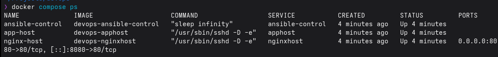
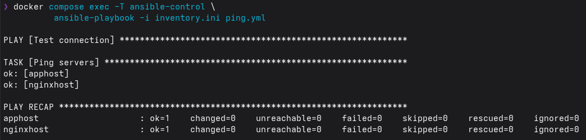
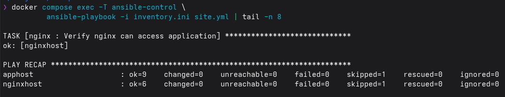
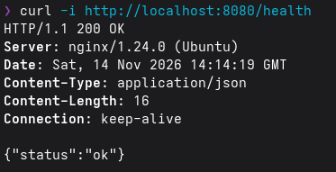

# Лабораторная №4 - Ansible

Проект включает три контейнера в одной сети, управляющий Ansible и два чистых Ubuntu-сервера с SSH. 

## Состав

- `ansible-control` - запускает playbook;
- `nginx-host` - чистый сервер, на котором Ansible устанавливает Nginx;
- `app-host` - чистый сервер, на котором Ansible устанавливает Go, копирует исходник, компилирует и запускает приложение через `run-app.sh`.

Все контейнеры в сети `labnet`. На хост опубликован только порт Nginx `8080` (в контейнере `80`). Приложение отвечает на `/` и `/health`.

## Запуск

Нужны Docker Engine, Docker Compose Plugin и свободный порт 8080. Из корня репозитория:

```bash
chmod +x setup.sh
./setup.sh
```

Эквивалентно по шагам:

```bash
docker compose up -d --build
docker compose exec -T ansible-control ansible-playbook -i inventory.ini ping.yml
docker compose exec -T ansible-control ansible-playbook -i inventory.ini site.yml
```

В Dockerfile целевых серверов устанавливаются только SSH, Python и sudo. Установка Nginx, Go и развёртывание приложения происходят в Ansible, а не при сборке Docker-образов.

## Проверка и скриншоты

```bash
docker compose ps
# Проверка связи
docker compose exec -T ansible-control ansible-playbook -i inventory.ini ping.yml
# Повторное выполнение не должно вносить изменений
docker compose exec -T ansible-control ansible-playbook -i inventory.ini site.yml
# Работоспособность через Nginx
curl -i http://localhost:8080/health
```

Ожидаемый статус `HTTP/1.1 200 OK`, тело `{"status":"ok"}`. При повторном playbook после успешного развёртывания ожидается `changed=0`, `failed=0`.

Скриншоты получены при локальном запуске лабораторной и включены в репозиторий.

### Запущенные Docker-контейнеры



### Проверка доступности серверов через Ansible



### Повторное выполнение playbook (идемпотентность)



### Проверка HTTP-ответа через Nginx



## Остановка

```bash
docker compose down
```
